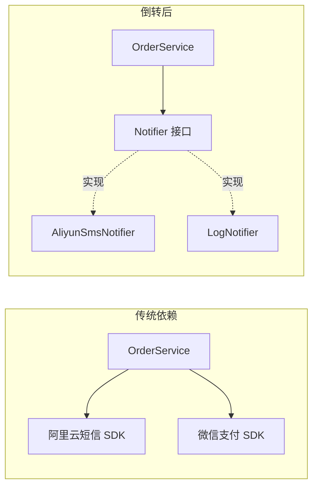

# 面向对象六大设计原则工程实践：开闭、里氏代换、依赖倒转、接口隔离、迪米特与合成复用


把开闭、里氏代换、依赖倒转、接口隔离、迪米特、合成复用六条原则从口号还原成可执行的判据：每条原则配反例代码、修正写法、真实踩坑与优先级，并说明它们什么时候彼此冲突、什么时候根本不该用。

设计原则是面试里最容易被背成口号、又在代码评审中最容易被误用的东西。**"对扩展开放、对修改关闭"这八个字，几乎人人都能背，但真正判断一段代码是否违反它，需要的是"下一次需求变更会长什么样"的具体想象**。原则的价值不在于正确，而在于它给出了六把不同角度的尺子，让你在评审时能说清楚"这里为什么难受"。

> 本文不绑定具体框架版本。原则的出处为 Robert C. Martin 关于 SOLID 的系列论述、Barbara Liskov 1987 年关于数据抽象与层次（Data Abstraction and Hierarchy）的报告、Northeastern University 1987 年 Aspect-Oriented Programming 论文中提出的 Demeter 法则，以及 GoF《设计模式》（1994）中"优先使用对象组合而非类继承"的建议。示例代码基于 Java 17 语法（`record`、`sealed`），Spring 相关只描述公开文档中存在的扩展点，不涉及具体小版本特性。事实核对日期：**2026-11-24**。

## 一、先说结论

六条原则不是六个平行的教条，它们分别回答六个不同的问题：

| 原则 | 回答的问题 | 一句话判据 | 违反时的典型症状 | 主要落地手段 |
|---|---|---|---|---|
| **开闭（OCP）** | 新需求来了，要改多少旧代码？ | 新增一种"类型"时，是否只加新类、不动分发逻辑 | 一个方法里长出一排 `if (type == ...)`，每加一种就要改一遍 | 策略 + 多态 + 注册表（Spring 注入 `Map<String, T>`） |
| **里氏代换（LSP）** | 子类能不能安全地当成父类用？ | 换成子类后，调用方原有的假设是否仍成立 | 子类抛父类没有的异常、空实现、悄悄改语义 | 组合替代继承；契约写进接口注释与断言 |
| **依赖倒转（DIP）** | 业务逻辑依赖的是抽象还是实现？ | 高层模块的 import 里有没有厂商 SDK | 换短信/支付厂商要改业务层，单测必须连真实中间件 | 面向接口编程 + 构造器注入 + 适配层 |
| **接口隔离（ISP）** | 客户端被迫实现了多少它用不到的方法？ | 接口里是否每个方法都被所有实现者有意义地实现 | 出现一堆 `throw new UnsupportedOperationException()` | 按调用方拆小接口，读写分离、管理端与用户端分离 |
| **迪米特（LoD）** | 一个对象知道了多少不该知道的内部结构？ | 是否出现 `a.getB().getC().getD()` 的连续调用 | 上游字段改名，下游十几个类一起编译失败 | 在朋友对象上暴露意图方法，或用 DTO 组装 |
| **合成复用（CRP）** | 复用是靠继承还是靠组合？ | 继承关系是否同时满足"is-a 且可替换" | `extends BaseXxxService` 只为蹭两个工具方法 | 组合 + 委托；继承只用于真正的子类型化 |

如果只能记一条，记这句：**开闭决定代码的寿命，里氏代换决定代码的正确性，其余四条决定代码的耦合度**。正确性永远优先于可扩展性——一个不能正确替换的子类，扩展性再好也是负债。

## 二、这六条原则的来处与关系

六条原则常被混着叫"SOLID"，但严格说：SOLID 是五个字母（单一职责 SRP、开闭 OCP、里氏代换 LSP、接口隔离 ISP、依赖倒转 DIP），迪米特法则与合成复用原则是另外两条常被并入"面向对象设计原则"的经验规则。

| 归类 | 原则 | 关注层次 |
|---|---|---|
| SOLID 中的四条 | 开闭、里氏代换、接口隔离、依赖倒转 | 类型设计与依赖方向 |
| 补充的架构级经验 | 迪米特法则、合成复用原则 | 对象协作边界与复用方式 |

本文聚焦项目笔记中列出的这六条。**单一职责（SRP）不在其中**，因为它的判据是"一个类是否有多个变更原因"，更接近模块划分问题，与本文这六条"如何在既有结构上安全演进"的视角不同，值得单独成文。

六条原则之间不是并列关系，而是有依赖顺序的：

```mermaid
flowchart TD
    A[需求变更] --> B{新增的是"类型"还是"行为"?}
    B -->|新增类型| C[开闭原则: 加类不改分发]
    B -->|修改既有行为| D{是否改动了父类契约?}
    D -->|是| E[里氏代换: 先保证可替换]
    D -->|否| F{依赖的是抽象吗?}
    F -->|否| G[依赖倒转: 抽接口 + 注入]
    F -->|是| H{接口是否过胖?}
    H -->|是| I[接口隔离: 按调用方拆分]
    H -->|否| J{是否跨对象深度取值?}
    J -->|是| K[迪米特: 收敛到意图方法]
    J -->|否| L[合成复用: 优先组合而非继承]
```

这张图的顺序是有意的：**先判断正确性（LSP），再判断结构（ISP/CRP），最后才谈演进（OCP）与解耦（DIP）**。很多团队反着来，一上手就抽象接口、拆策略，结果底层子类已经破坏了父类契约，抽象只是把 bug 藏得更深。

## 三、开闭原则：对扩展开放，对修改关闭

### 1. 判据不是"有没有 if"，而是"改哪里"

开闭原则（Open-Closed Principle）的准确表述是：**软件实体应该对扩展开放、对修改关闭**。落到工程上就一句：新增一种业务类型时，理想情况是"只新增文件"，而不是"回到旧文件里加分支"。

注意两个常见误解：

- 有 `if` 不等于违反。业务规则本身就有限的场景（比如订单状态机只有固定的几个状态），写 `switch` 完全正确，硬拆策略反而是过度设计。
- 无 `if` 不等于遵守。用反射 + 字符串拼类名把分支藏起来，只是把修改点从代码挪到了配置，可读性和可测性都变差。

真正的判据是**变更的局部性**：这次需求变更会让多少个已上线、已测试的文件重新编译、重新回归。

### 2. 反例：优惠券计算器

商城项目里最典型的形态：

```java
/**
 * 优惠券计算器（反例）
 * 每新增一种券类型，都要回来改这个方法，回归面覆盖全部券种。
 */
public class CouponCalculator {

    // 根据券类型字符串做分发，新增类型必须修改此方法
    public BigDecimal calculate(String couponType, BigDecimal amount) {
        if ("FULL_REDUCTION".equals(couponType)) {
            // 满减：满 100 减 10
            return amount.compareTo(new BigDecimal("100")) >= 0
                    ? amount.subtract(new BigDecimal("10"))
                    : amount;
        } else if ("DISCOUNT".equals(couponType)) {
            // 折扣：九折
            return amount.multiply(new BigDecimal("0.9"));
        } else if ("FREE_SHIPPING".equals(couponType)) {
            // 免运费：不改变商品金额
            return amount;
        }
        throw new IllegalArgumentException("未知券类型: " + couponType);
    }
}
```

这段代码的问题不是丑，而是**变更成本随券种数量线性增长**：加"满两件打折"要改这里、改单测、回归全部已有券种；`couponType` 拼错只有运行时才发现。

### 3. 正例：策略 + Spring 注册表

```java
/**
 * 优惠券计算策略：一种券一个实现，新增券种只需新增实现类。
 */
public interface CouponStrategy {

    /**
     * 返回本策略支持的券类型编码，用于注册与路由
     */
    String type();

    /**
     * 计算优惠后的应付金额
     *
     * @param amount 优惠前金额
     * @return 优惠后金额，不允许返回负数
     */
    BigDecimal apply(BigDecimal amount);
}

/**
 * 满减券策略
 */
@Component
public class FullReductionCouponStrategy implements CouponStrategy {

    @Override
    public String type() {
        return "FULL_REDUCTION";
    }

    @Override
    public BigDecimal apply(BigDecimal amount) {
        // 门槛判断放在策略内部，调用方无需了解券规则
        return amount.compareTo(new BigDecimal("100")) >= 0
                ? amount.subtract(new BigDecimal("10"))
                : amount;
    }
}

/**
 * 券计算门面：只负责路由，不包含任何具体券规则
 * 依赖注入时 Spring 会把所有 CouponStrategy 实现按 bean 名收集成 Map。
 */
@Component
public class CouponCalculator {

    private final Map<String, CouponStrategy> strategies;

    // 构造注入，避免运行期空指针；Map 的 key 是 bean 名称
    public CouponCalculator(List<CouponStrategy> strategyList) {
        this.strategies = strategyList.stream()
                .collect(Collectors.toUnmodifiableMap(CouponStrategy::type, Function.identity()));
    }

    /**
     * 按券类型路由到对应策略
     *
     * @throws IllegalArgumentException 券类型未注册时抛出，属于配置错误而非业务错误
     */
    public BigDecimal calculate(String couponType, BigDecimal amount) {
        CouponStrategy strategy = strategies.get(couponType);
        if (strategy == null) {
            throw new IllegalArgumentException("未注册的券类型: " + couponType);
        }
        return strategy.apply(amount);
    }
}
```

改造后，新增"满两件打折"只需要新增一个 `@Component` 类。**路由逻辑与业务规则分离，回归面收敛到新类**。这里 Spring 只提供了"按类型收集 Bean"这个公开能力，没有用它做任何魔法。

### 4. 什么时候不要追求开闭

| 场景 | 建议 | 原因 |
|---|---|---|
| 分支数量 ≤ 2 且业务上确定不会增长 | 保留 `if/else` | 抽象成本高于收益 |
| 变化点无法预知（新业务，需求还在探索） | 先写直白实现，等第三次重复再抽 | 提前抽象会锁死错误的模型 |
| 分支差异体现在"数据"而非"行为" | 用配置表/枚举 + 一次查询 | 抽象成类反而增加理解成本 |

一条实操经验：**同一处分支第三次出现时再抽象**。第一次写直白、第二次复制、第三次抽象——这条"三次法则"能过滤掉大部分过度设计。

## 四、里氏代换原则：子类型必须能替换父类型

### 1. 定义与四条可执行判据

里氏代换原则（Liskov Substitution Principle）的原始表述偏学术：**如果对每个类型为 S 的对象 o1，都有类型为 T 的对象 o2，使得以 T 定义的所有程序 P 在把 o2 替换成 o1 时行为不变，那么 S 是 T 的子类型**。

工程上把它拆成四条可以写进评审清单的判据：

| 判据 | 含义 | 违反示例 |
|---|---|---|
| **前置条件不能加强** | 子类不能要求比父类更多的输入约束 | 父类 `transfer(amount > 0)`，子类额外要求"必须是工作日" |
| **后置条件不能减弱** | 子类不能少做父类承诺的事 | 父类承诺"返回非空列表"，子类返回 `null` |
| **不抛父类未声明的异常** | 包括受检异常与运行期异常的语义扩展 | 父类只抛 `BizException`，子类抛 `IllegalStateException` |
| **不改变可观察语义** | 不变量、副作用、幂等性保持一致 | 父类 `save` 幂等，子类每次插入新记录 |

### 2. 反例：冻结账户

```java
/**
 * 账户服务（父类契约：transfer 成功即扣减并返回流水号）
 */
public class AccountService {

    /**
     * 转账
     *
     * @return 流水号，永不为 null
     */
    public String transfer(String from, String to, BigDecimal amount) {
        // 扣减、入账、生成流水
        return doTransfer(from, to, amount);
    }
}

/**
 * 冻结账户服务（反例：以继承方式表达"不能转账"）
 * 问题：调用方按父类契约没有准备捕获 IllegalStateException，
 * 替换后原有 try-catch 结构失效，异常直接穿透到接口层变成 500。
 */
public class FrozenAccountService extends AccountService {

    @Override
    public String transfer(String from, String to, BigDecimal amount) {
        throw new IllegalStateException("账户已冻结");
    }
}
```

这段代码在很多项目里真实存在，因为"冻结账户就是一种账户"听起来很像 is-a。但**调用方依赖的契约是"transfer 会返回流水号或抛出业务异常"，子类加强成了"直接抛运行期异常"**，这就是典型的前置条件加强 + 异常语义外扩。

### 3. 修正：用状态 + 组合表达"不能转账"

```java
/**
 * 账户（用状态而非继承表达可用性）
 * 冻结不是一种新的账户类型，而是账户的一个状态。
 */
public class Account {

    // 账户状态：冻结态由业务规则决定是否允许转出
    private AccountStatus status;

    private final TransferGateway gateway;

    public Account(TransferGateway gateway) {
        this.gateway = gateway;
    }

    /**
     * 尝试转出
     *
     * @throws BizException 账户冻结时抛出统一业务异常，调用方一处捕获
     */
    public String transferOut(String to, BigDecimal amount) {
        if (status == AccountStatus.FROZEN) {
            // 与父类契约保持一致：业务失败统一抛 BizException
            throw new BizException("ACCOUNT_FROZEN", "账户已冻结，无法转出");
        }
        return gateway.transferOut(this, to, amount);
    }
}
```

判断继承是否成立，有一个非常快的自查：**如果把子类对象塞进一个声明为父类型的变量，调用方是否需要加 `instanceof` 或额外 try-catch？如果需要，这个继承关系就是错的**。

### 4. Java 标准库里现成的教训

| 案例 | 问题 | 结论 |
|---|---|---|
| `java.util.Properties extends Hashtable<Object,Object>` | 父类允许任意类型键值，而 `Properties` 的 `getProperty`/`setProperty` 只处理 `String`，通过 `put` 塞入非字符串键后语义被破坏 | 经典的历史包袱，新代码不要模仿 |
| `Stack extends Vector` | 栈只应暴露栈语义，却继承了 `Vector` 的全部索引访问与线程安全开销 | 现代写法用 `ArrayDeque` 组合 |
| 重写 `equals` 却不同步 `hashCode` | 破坏父类 `Object` 的契约（相等对象哈希必须相等），`HashMap` 行为不可预期 | 属于契约违反，不是风格问题 |

这也是为什么《Effective Java》反复强调"组合优于继承"——继承会把父类的实现细节变成子类的契约负担。

## 五、依赖倒转原则：面向抽象，不面向实现

### 1. 两个"倒转"到底倒了什么

依赖倒转原则（Dependency Inversion Principle）包含两条：

1. **高层模块不应该依赖低层模块，二者都应该依赖抽象。**
2. **抽象不应该依赖细节，细节应该依赖抽象。**

"倒转"指的是依赖方向的反转：传统分层里，业务层直接调用基础设施（数据库、短信、支付 SDK），依赖箭头从上往下；倒转后，业务层只依赖自己定义的接口，基础设施反过来实现这个接口——**依赖箭头指向了抽象，也就是指向了高层**。



### 2. 反例：业务层被厂商类型污染

```java
/**
 * 通知服务（反例：直接依赖厂商 SDK 的请求/响应类型）
 */
@Service
public class NotifyService {

    private final AliyunSmsClient client;   // 厂商 SDK 类型

    public NotifyService(AliyunSmsClient client) {
        this.client = client;
    }

    /**
     * 发送验证码
     * 返回值直接暴露厂商响应对象，上层被迫了解 SendSmsResponse 的结构。
     */
    public SendSmsResponse sendCode(String phone, String code) {
        SendSmsRequest request = new SendSmsRequest();
        request.setPhoneNumbers(phone);
        request.setTemplateCode("SMS_0001");
        request.setTemplateParam("{\"code\":\"" + code + "\"}");
        return client.sendSms(request);   // 厂商异常也未转换，直接穿透
    }
}
```

后果非常具体：

- 换厂商 = 改业务层 + 改所有调用方 + 改所有测试。
- 单测必须构造厂商的 `SendSmsResponse`，或者干脆连不上就跳过。
- 厂商 SDK 的异常类型泄漏到接口层，`GlobalExceptionHandler` 无法统一处理。

### 3. 正例：自定义抽象 + 适配器实现细节

```java
/**
 * 通知端口：由业务层定义，只描述业务需要的能力
 * 注意：不出现任何厂商类型、不出现厂商异常。
 */
public interface Notifier {

    /**
     * 发送验证码短信
     *
     * @throws NotifyException 统一的发送失败异常，携带可重试标记
     */
    void sendVerificationCode(String phone, String code);
}

/**
 * 阿里云短信适配器：把厂商 API 翻译成业务端口
 * 所有厂商细节（请求对象、响应码、异常类型）都封在这个类里。
 */
@Component
public class AliyunSmsNotifier implements Notifier {

    private final AliyunSmsClient client;

    public AliyunSmsNotifier(AliyunSmsClient client) {
        this.client = client;
    }

    @Override
    public void sendVerificationCode(String phone, String code) {
        SendSmsRequest request = new SendSmsRequest();
        request.setPhoneNumbers(phone);
        request.setTemplateCode("SMS_0001");
        request.setTemplateParam("{\"code\":\"" + code + "\"}");
        try {
            SendSmsResponse response = client.sendSms(request);
            // 厂商用字符串码表示结果，这里必须显式判定，不能只看有没有抛异常
            if (!"OK".equals(response.getCode())) {
                throw new NotifyException(response.getMessage(), isRetryable(response.getCode()));
            }
        } catch (ClientException e) {
            // 厂商异常统一翻译为业务异常，避免泄漏到上层
            throw new NotifyException("短信发送失败", true, e);
        }
    }

    /**
     * 判断厂商错误码是否值得重试（限流类可重试，参数类不可重试）
     */
    private boolean isRetryable(String code) {
        return "isv.BUSINESS_LIMIT_CONTROL".equals(code);
    }
}

/**
 * 业务服务：只依赖 Notifier 抽象
 */
@Service
public class NotifyService {

    private final Notifier notifier;

    public NotifyService(Notifier notifier) {
        this.notifier = notifier;
    }

    public void sendLoginCode(String phone, String code) {
        notifier.sendVerificationCode(phone, code);
    }
}
```

依赖倒转的收益在测试里最直观：`NotifyService` 的单测可以直接注入一个 lambda 实现的 `Notifier`，断言"是否被调用、参数是否正确"，完全不需要网络。

### 4. 依赖倒转不等于"每层都加接口"

这是最常见的误用。判据是**是否存在真实的替换或隔离需求**：

| 值得抽接口 | 不值得抽接口 |
|---|---|
| 外部依赖（短信、支付、对象存储、第三方 API） | 内部纯计算工具类 |
| 存在多实现（多支付渠道、多存储后端） | 只有一个实现且确定不会变 |
| 需要隔离测试（时钟、随机数、文件系统） | 同一模块内的简单协作 |

只为了"符合 DIP"给每个 Service 都配一个 `XxxService` + `XxxServiceImpl`，会让项目多出一倍文件，却拿不到任何实际收益。**接口是给变化留的门，不是给代码加的仪式**。

## 六、接口隔离原则：别让客户端依赖它不用的方法

### 1. 判据：有没有"被迫的空实现"

接口隔离原则（Interface Segregation Principle）说的是：**客户端不应该被迫依赖它不使用的方法；一个类对另一个类的依赖应该建立在最小的接口上**。

它和单一职责容易混：**单一职责看"类的变更原因"，接口隔离看"调用方的使用面"**。一个接口可以职责单一，但对某个调用方来说仍然太大。

最直接的信号是：实现类里出现 `throw new UnsupportedOperationException()`，或者空方法体 + 一行注释"暂不支持"。

### 2. 反例：后台与前台共用一个胖接口

```java
/**
 * 订单服务接口（反例：把用户侧、管理侧、定时任务侧的方法塞在一起）
 */
public interface OrderService {

    OrderDetail queryForUser(Long orderId, Long userId);

    List<OrderDetail> queryPage(OrderQuery query);

    void close(Long orderId, String reason);

    void forceRefund(Long orderId, BigDecimal amount, String operator);

    void exportDailyReport(LocalDate date, OutputStream out);
}
```

后果是具体的：

- 用户侧的 Controller 依赖了这个接口，就"看得见" `forceRefund`，一旦有人误用就是资损。
- 单元测试写 mock 时，必须实现全部五个方法。
- 后续拆服务时，这三个使用方被同一个接口焊死在一起。

### 3. 正例：按调用方拆接口

```java
/**
 * 用户侧订单查询：只暴露本人可查询的只读能力
 */
public interface UserOrderQuery {

    /**
     * 查询当前用户自己的订单
     *
     * @throws BizException 订单不存在或不属于该用户时抛出，不区分两种情况以免泄露信息
     */
    OrderDetail queryOwn(Long orderId, Long userId);
}

/**
 * 管理侧订单运维：涉及资损的操作单独成接口，便于做权限与审计切面
 */
public interface AdminOrderOps {

    /**
     * 强制退款，必须记录操作人与原因
     */
    void forceRefund(Long orderId, BigDecimal amount, String operator, String reason);
}

/**
 * 订单实现类可以同时实现多个接口，但每个调用方只依赖它需要的那一个
 */
@Service
public class OrderServiceImpl implements UserOrderQuery, AdminOrderOps {
    // 实现略
}
```

拆分的直接收益是**权限控制的位置变清楚了**：`AdminOrderOps` 上挂一个 `@PreAuthorize` 或审计切面，覆盖面就是精确的，不会误伤用户侧查询。

### 4. 标准库与框架里的范例

| 位置 | 拆分方式 | 说明 |
|---|---|---|
| `Runnable` / `Callable` | 无返回值 / 有返回值 | 提交到线程池时按需要选择，不强迫实现方写 `return null` |
| `java.util.Collection` 体系 | `Collection` / `Set` / `List` / `Queue` | 需要"不重复"就依赖 `Set`，不依赖 `Collection` 的通用面 |
| Spring Data 仓储 | `CrudRepository` / `PagingAndSortingRepository` / `JpaRepository` | 只要 CRUD 就继承第一层，避免被迫接受分页与 JPA 专有能力 |
| JDBC | `Connection` / `Statement` / `ResultSet` | 各自职责边界清晰，未合并成一个大接口 |

接口隔离不是"接口越小越好"。**拆到每个方法一个接口，会让调用方为了一个操作注入五个对象**。合理的粒度是"一个使用场景一组操作"。

## 七、迪米特法则：只和直接朋友说话

### 1. 定义与"朋友"的边界

迪米特法则（Law of Demeter，LoD）也常被叫作"最少知识原则"：**一个对象应该对其他对象保持最少的了解，只与直接的朋友通信**。

"直接朋友"有明确定义，包括：

- 当前对象自身
- 以参数形式传入的对象
- 当前对象持有的成员对象
- 当前对象创建的对象

**不包括**朋友的朋友。所以下面这种连续调用就是典型违反：

```java
// 违反迪米特：OrderService 通过 Order 摸到了 User，又摸到了 Address
String city = order.getUser().getAddress().getCity();
```

这句代码叫"火车残骸"（train wreck）。它的危害不是长，而是**依赖链上任何一个环节改结构，这里都要改**：`User` 去掉 `address` 字段改成 `List<Address>`，全项目的取值代码一起崩。

### 2. 修正：在朋友身上暴露意图方法

```java
/**
 * 订单（把"收货城市"作为订单自己的能力暴露出来）
 * 外部不需要知道地址是存在 User 上还是存在 Order 上。
 */
public class Order {

    private final Long id;
    private final Receiver receiver;   // 收货信息，属于订单的快照，不随用户资料变化

    /**
     * 返回收货城市，用于运费计算与路由
     *
     * @return 城市名，收货信息缺失时返回空字符串而不是 null
     */
    public String receiverCity() {
        return receiver == null ? "" : receiver.city();
    }
}

/**
 * 运费计算：只和 Order 这一个朋友通信
 */
public class FreightCalculator {

    public BigDecimal calc(Order order) {
        // 只调用 order 自己的方法，不穿透其内部结构
        return switch (order.receiverCity()) {
            case "北京", "上海", "广州", "深圳" -> new BigDecimal("8");
            case "" -> BigDecimal.ZERO;          // 虚拟商品无收货地址
            default -> new BigDecimal("12");
        };
    }
}
```

顺带修正了一个隐蔽问题：**收货地址应该是订单的快照**。如果每次运费计算都去读 `user.getAddress()`，用户改地址后历史订单的运费口径就变了——迪米特法则经常顺手把这类领域建模错误也一起暴露出来。

### 3. 边界：数据结构可以"被穿透"

迪米特法则针对的是**对象**（有行为、有封装），不是**数据结构**（只装数据、没有行为）。所以在 DTO / VO 的组装层，出现多层取值是合理的：

```java
/**
 * 订单详情组装器：这里是数据结构转换，不是对象协作
 * 组装层穿透 DTO 结构属于正常用法，不要为了"遵守迪米特"再包一层。
 */
public OrderDetailVO assemble(Order order, User user, Address address) {
    OrderDetailVO vo = new OrderDetailVO();
    vo.setOrderNo(order.getOrderNo());
    vo.setReceiverName(address.getReceiverName());
    vo.setCity(address.getCity());
    return vo;
}
```

判断标准很简单：**取值是为了"转换格式"还是为了"做业务决策"**。前者可以穿透，后者应该收敛。

| 场景 | 是否违反 | 原因 |
|---|---|---|
| 组装层从多个 DTO 取值拼 VO | 不违反 | 数据结构转换，无业务决策 |
| 业务方法里 `order.getUser().getLevel().getDiscount()` 算价 | 违反 | 业务决策依赖了三层内部结构 |
| 链式调用 Builder / Stream | 不违反 | 返回的是同一对象的上下文，不是"朋友的朋友" |
| 通过 `getList().add(x)` 修改内部集合 | 违反 | 泄漏内部可变状态，且绕过校验 |

最后一行值得单独强调：**返回内部集合的引用，比多打两个点更危险**。正确做法是返回 `List.copyOf(...)` 或不可变视图。

## 八、合成复用原则：优先组合，而非继承

### 1. 继承的三个硬伤

合成复用原则（Composite Reuse Principle）主张：**尽量使用组合或聚合实现复用，其次才考虑继承**。继承的问题不在语法，而在三件事：

| 硬伤 | 具体表现 |
|---|---|
| **封装被击穿** | 子类依赖父类的实现细节（protected 字段、方法调用顺序），父类重构即破坏子类 |
| **编译期绑定** | 继承关系在编译期确定，运行时无法替换；组合可以在运行时换实现 |
| **层级爆炸** | 两个维度的变化用继承表达，类数量呈乘法增长（桥接模式正是为解决它而生） |

### 2. 反例：为了复用工具方法而继承

```java
/**
 * 订单服务（反例：为了复用日志与校验方法而继承基类）
 */
public class OrderService extends BaseService {

    public void createOrder(CreateOrderCommand command) {
        // 从父类继承了 log()、validate()、currentUser() 等方法
        validate(command);
        log("create order");
        // ... 业务逻辑
    }
}
```

这种写法的代价会随时间显现：

- `BaseService` 一旦被 20 个 Service 继承，任何改动都要考虑 20 个子类的兼容性，这个类会迅速变成"上帝基类"。
- 想给其中一个 Service 换个日志实现？做不到，因为方法是继承来的。
- 单测时必须准备父类依赖的所有上下文（往往包括静态工具、ThreadLocal）。

### 3. 正例：组合 + 委托

```java
/**
 * 订单创建服务：通过组合获得能力，每个依赖都可替换、可单独测试
 */
@Service
public class OrderService {

    private final OrderRepository repository;
    private final InventoryGateway inventory;      // 库存端口
    private final AuditLogger auditLogger;         // 审计日志，独立组件

    // 构造注入：依赖关系显式声明，不藏在父类里
    public OrderService(OrderRepository repository,
                        InventoryGateway inventory,
                        AuditLogger auditLogger) {
        this.repository = repository;
        this.inventory = inventory;
        this.auditLogger = auditLogger;
    }

    /**
     * 创建订单：库存预占成功后落库，失败则整体回滚
     */
    @Transactional(rollbackFor = Exception.class)
    public Long createOrder(CreateOrderCommand command) {
        Long orderId = repository.nextId();
        // 委托给库存端口，订单服务不关心库存是本地表还是远程服务
        inventory.reserve(command.skuId(), command.quantity());
        repository.save(Order.create(orderId, command));
        // 审计异步化由 AuditLogger 自己决定，订单服务只表达意图
        auditLogger.record("ORDER_CREATED", orderId, command.operatorId());
        return orderId;
    }
}
```

### 4. 什么时候继承是对的

继承不是原罪，它成立的条件只有一个：**同时满足 is-a 语义 + 可替换性（LSP）+ 父类为继承而设计**。

| 适合继承 | 不适合继承 |
|---|---|
| 抽象类定义模板流程，子类只填变化步骤（模板方法） | 只为复用几个工具方法 |
| 异常体系（`BizException extends RuntimeException`） | 为复用字段而继承实体类 |
| 框架扩展点（如 `OncePerRequestFilter`、`BeanPostProcessor`） | 想修改父类行为但语义上不是子类型 |

一个实用的自查清单：**继承后，我是否愿意把子类对象传给所有接收父类的方法？如果有一处不愿意，就改用组合**。

## 九、六条原则的冲突与优先级

原则之间会互相拉扯，这不是理论瑕疵，而是真实的设计取舍：

| 冲突组合 | 表现 | 取舍 |
|---|---|---|
| **开闭 vs 复杂度** | 每种变化都抽策略，类数量爆炸 | 三次法则：重复出现三次再抽象 |
| **接口隔离 vs 依赖倒转** | 接口拆得太细，注入对象过多 | 按"使用场景"而非"方法"拆，一组相关操作一个接口 |
| **里氏代换 vs 合成复用** | 想复用代码但子类不可替换 | 直接放弃继承，用组合 + 委托 |
| **迪米特 vs 贫血模型** | DTO 只有 getter，业务方法无处安放 | 领域对象承载行为，DTO 只用于边界传输 |
| **依赖倒转 vs 简单性** | 每个 Service 都配接口，文件翻倍 | 只对外部依赖与多变实现抽接口 |

给一个可执行的优先级，评审时按这个顺序过：

1. **正确性优先**：先确认没有违反里氏代换与契约（异常、空值、幂等）。
2. **边界优先**：确认依赖方向没有倒挂（业务层没有 import 厂商 SDK）。
3. **粒度其次**：接口是否按调用方拆分，对象是否越界取值。
4. **演进最后**：是否需要为未来的扩展点做抽象——此时才谈开闭。

顺序反了，就会出现"抽象很优雅，但换个实现就报错"的代码。

## 十、常见追问

**1. 抽象到底什么时候做？**

看变化的确定性，不看代码美观度。**已经变了两次的地方，第三次抽象；还没变过的地方，等它变**。真正难的是判断"这个变化会不会重复发生"——同类支付渠道、同类通知渠道、同类文件存储，这些几乎必然会增加；而某个特定业务的特有规则，往往只出现一次。

**2. 接口和抽象类怎么选？**

接口表达"能做什么"（能力契约），抽象类表达"是什么 + 部分怎么做"（骨架复用）。因为 Java 单继承，**优先接口**；只有当需要共享实现且确实存在 is-a 关系时，才用抽象类。Java 8 之后接口可以有 `default` 方法，进一步降低了抽象类的必要性。

**3. 迪米特法则会不会导致大量"转发方法"？**

会，这是它的成本。所以只在**跨模块、跨层**的边界严格应用；同一个聚合内部（比如 `Order` 与 `OrderItem`）不必强行收敛。原则的适用半径和模块边界一致。

**4. DTO 算不算违反迪米特？**

不算。DTO 是数据结构，没有封装意图。真正的违反是"在业务逻辑里通过 DTO 链做决策"。

**5. 这些原则和设计模式什么关系？**

原则是判据，模式是解法的常见形态。策略模式服务于开闭，适配器服务于依赖倒转，门面服务于迪米特，桥接服务于合成复用。**先有问题再选模式，不要先背模式再找场景**。

## 十一、踩坑清单

| 坑 | 现象 | 根因 | 修正 |
|---|---|---|---|
| 用继承表达状态 | 冻结账户继承账户服务 | 把状态误当子类型 | 状态字段 + 组合 |
| 为复用工具方法继承基类 | `BaseService` 越滚越大 | 复用方式选错 | 抽成独立组件注入 |
| 每个 Service 都配接口 | 文件翻倍、跳转成本高 | 把 DIP 当仪式 | 只对外部依赖抽接口 |
| 接口过胖 | 实现类一堆 `UnsupportedOperationException` | 按"实体"而非"调用方"划分接口 | 读写分离、端侧分离 |
| 业务层直接返回厂商 DTO | 换 SDK 全线改动 | 缺少适配层 | 定义端口接口 + 适配器 |
| 返回内部集合引用 | 调用方 `getList().clear()` 破坏不变量 | 封装泄漏 | 返回不可变副本 |
| 跨层连续取值 | `a.getB().getC().getD()` | 结构耦合 | 在朋友对象上暴露意图方法 |
| 一次性抽出所有策略 | 空实现与无用抽象 | 提前优化 | 三次法则 |
| 子类改了父类语义 | 覆写后幂等性丢失 | 无契约意识 | 契约写进注释，加断言与契约测试 |

## 十二、最佳实践

1. **把契约写进代码**：接口方法用 Javadoc 明确"参数约束、返回值是否可空、抛什么异常、是否幂等"。没有契约，里氏代换就无从判断。
2. **依赖注入用构造器**：字段注入隐藏依赖，`final` + 构造器让依赖关系在编译期可见，也让单测更简单。
3. **评审问三个问题**：这次改动动了几个旧文件？子类是否让调用方的假设失效？依赖箭头指向抽象还是实现？
4. **按变化频率分层**：变化快的外部依赖放适配层，变化慢的领域逻辑保持纯净，这样开闭原则才有落点。
5. **警惕"原则驱动"重构**：重构的触发条件应该是"下一次改动成本过高"，而不是"这段代码不符合某条原则"。
6. **度量而非争论**：用"改一个需求要动几个文件、几个测试类"作为客观指标，比争论抽象是否优雅有效得多。

**总结**：六条原则不是六条必须同时满足的规则，而是六种观察代码的角度。开闭原则决定代码能活多久，里氏代换决定代码是否还正确，依赖倒转和接口隔离决定耦合有多紧，迪米特决定边界有多清晰，合成复用决定结构会不会被继承层级拖垮。**落地时永远先保证正确性，再优化结构，最后才为未来预留扩展点**；反过来做，得到的是漂亮但不能跑的抽象。
